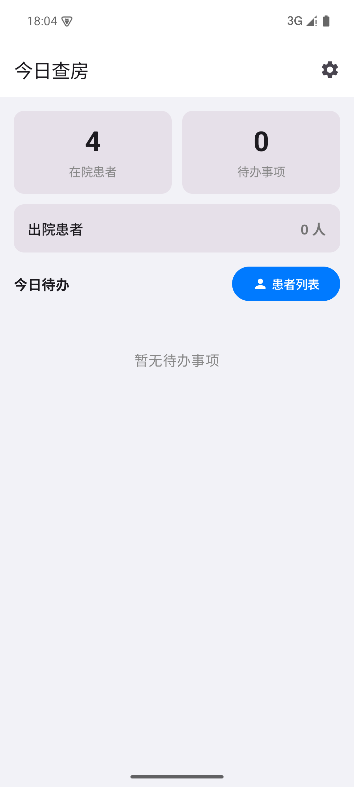
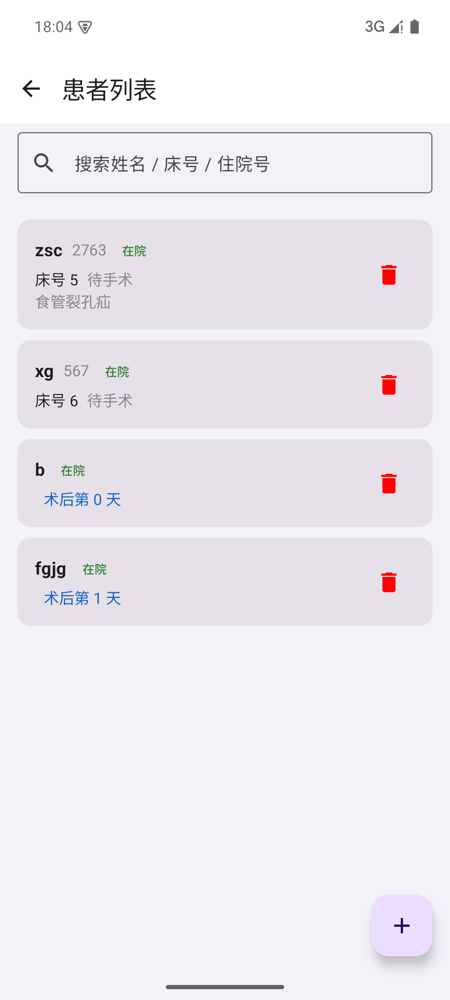
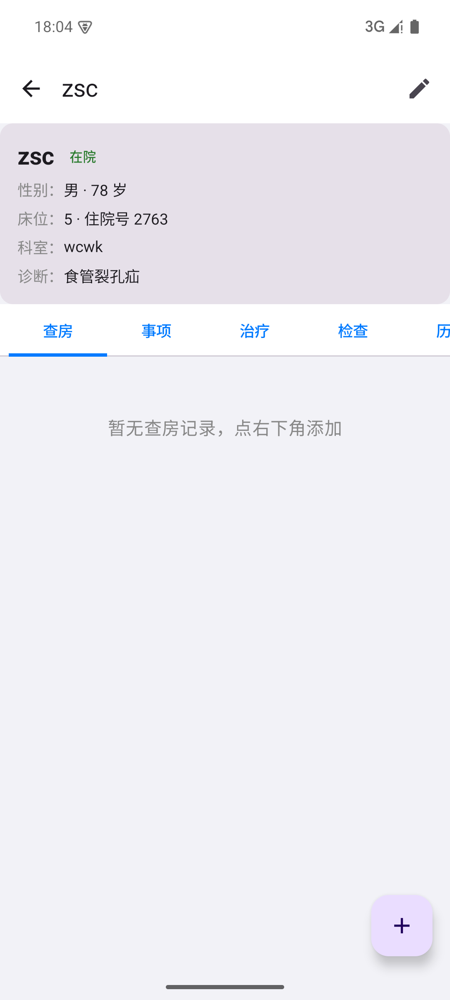
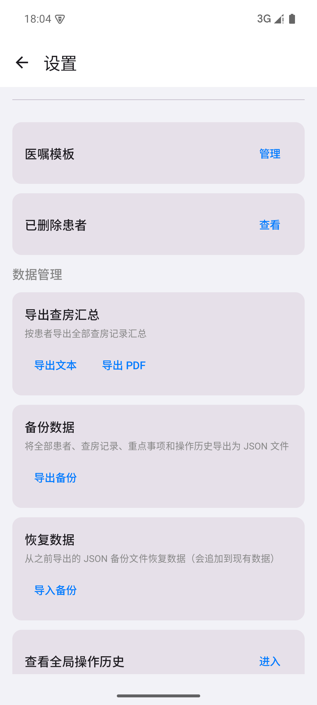

# 查了么 · 临床查房记录助手

一款面向临床医生的 Android 查房记录 App。每天查房时快速记录患者情况、重点事项、治疗医嘱、检查结果，自动生成统计，真正做到「少输入、快记录、可追溯」。

[](https://www.android.com)
[](https://kotlinlang.org)
[](https://developer.android.com/compose)
[](LICENSE)

## 界面截图

| 今日查房 | 患者列表 | 患者详情 | 设置 |
|:---:|:---:|:---:|:---:|
|  |  |  |  |

> 截图中的患者数据为演示用测试数据。

## 功能特性

### 患者管理
- 床号、住院号、姓名、性别、年龄、诊断、入院日期
- **诊断辅助**：ICD-10 全库（2235 条），支持拼音首字母缩写 + 汉字模糊匹配，半屏多选面板
- 手术日期 + 手术开始/结束时间（精确到分）
- 出院 / 取消出院、长按快捷操作
- 软删除回收站：删除后保留 7 天，可恢复
- 患者列表按床号递增排序，显示住院号、术后第几天 / 待手术

### 查房记录
- 文字记录 + 拍照 + 快速短语插入
- 按日期分组展示，同一天操作聚合

### 重点事项
- 首页按患者汇总待办，点击直达该患者「事项」标签
- 完成确认提示，同一床位事项合并展示

### 治疗记录
- 长期医嘱 / 临时医嘱
- **溶媒组 + 多味药**：一条水可加多种药（如 氯化钠 100ml + 奥美拉唑）
- 用法、剂量、单位、配伍溶媒选择
- 补液量按用法自动计算
- 医嘱模板（设置中管理），添加用药时一键调用
- 待审核用药（批量录入后一起审核）、停止医嘱、显示已停止开关

### 检查结果
- 检验 / 检查两类，拍照上传
- 图片点击放大、双指捏合缩放

### 统计
- 入院后第 1/2/3/6 天做了什么
- 术后第 1/2/3/6/9/12 天做了什么（出院日为统计截止）
- 抗生素使用天数（分别标注不同抗生素）
- 手术时长（小时分钟 + 分钟数，仅在统计中显示）

### 数据管理
- JSON 备份 / 恢复
- 查房汇总导出为文本 / PDF
- 全局操作历史追溯

## 技术栈

| 项目 | 技术 |
|------|------|
| 语言 | Kotlin |
| UI | Jetpack Compose + Material 3 |
| 架构 | MVVM + Repository |
| 数据库 | Room（本地 SQLite） |
| 导航 | Navigation Compose |
| 异步 | Kotlin Coroutines + Flow |
| 拼音搜索 | Pinyin4j |

## 项目结构

```
app/src/main/java/com/wardround/app/
├── data/          # Room 实体、DAO、Repository、诊断库
├── ui/            # Compose 界面
├── reminder/      # 提醒相关
├── MainActivity.kt
└── WardRoundApp.kt
```

## 构建

1. 安装 Android Studio（JDK 21、Android SDK 35、Build Tools 34）
2. 在项目根目录创建 `local.properties`，写入 SDK 路径：
   ```
   sdk.dir=D:/Android_SDK
   ```
3. 命令行构建：
   ```
   ./gradlew assembleDebug
   ```
4. 产物位于 `app/build/outputs/apk/debug/app-debug.apk`

## 数据与隐私

- 所有数据**仅保存在手机本地**（Room 数据库），不联网、不上传
- 支持手动备份/恢复，卸载前请先导出备份

## 版本历史

| 版本 | 主要更新 |
|------|----------|
| v1.7 | 设置页版本号/制作者、卡通医生图标、App 改名「查了么」 |
| v1.6 | 首页待办按患者汇总，点击直达事项标签 |
| v1.5 | 诊断库扩充为完整 ICD-10 库（2235 条） |
| v1.4 | 诊断输入辅助（拼音首字母 + 模糊、半屏多选） |
| v1.3 | 长期/临时医嘱、补液量按用法计算、溶媒组多味药 |

## License

[MIT](LICENSE)
